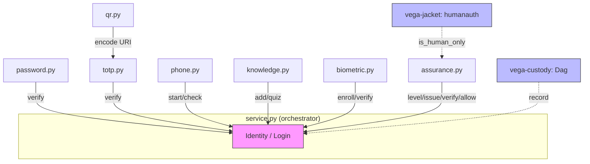
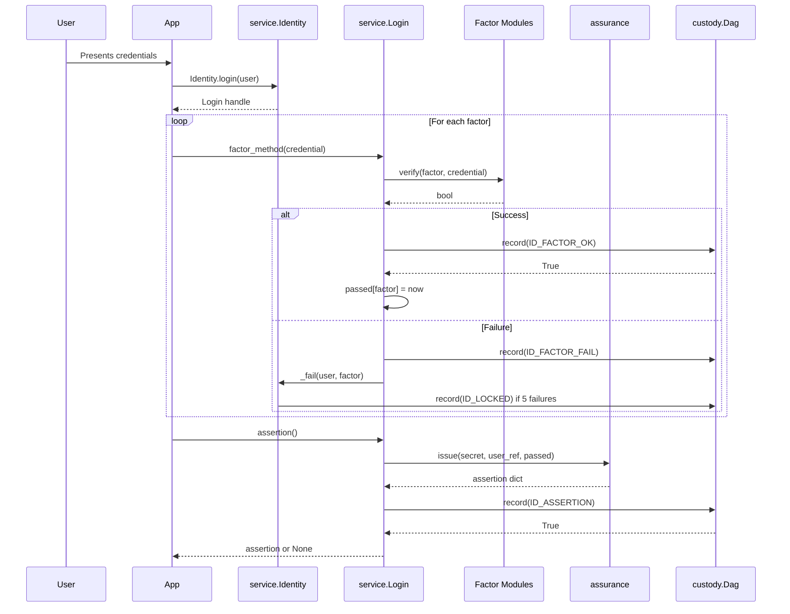

# vega-identity-sdk — Architecture

## At a glance

| Item | Value |
|------|-------|
| **Layer** | 1 (authority) |
| **Modules** | 7 (password, totp, qr, phone, knowledge, biometric, assurance, service) |
| **Depends on** | vega-custody-sdk (layer 0), vega-governance-jacket-sdk (layer 1) |
| **Consumed by** | vega-two-gate-sdk (layer 4), vega-harness-sdk (layer 6), vega-umbrella-sdk (layer 15) |

## Table of contents

- [1. The organism — family picture](#1-the-organism--family-picture)
- [2. Internal module diagram](#2-internal-module-diagram)
- [3. Sequence: end-to-end login](#3-sequence-end-to-end-login)
- [4. Trust boundaries](#4-trust-boundaries)
- [5. Fail-closed constraint points](#5-fail-closed-constraint-points)

## 1. The organism — family picture

The 16-layer Vega SDK stack with this repo's layer marked:

```
                 ┌──────────────────────────┐
                 │   THE HUMAN (the owner)  │  holds the only signing key;
                 │  authority starts here   │  spends it one action at a time
                 └────────────┬─────────────┘
                              v single-use signed commitments
 15 assemble   vega-umbrella-sdk        the family as one organism
 14 deliberate vega-council-sdk         multi-brain deliberation
              vega-galaxy-sdk          galaxy view of knowledge lattice
 13 watch      vega-governance-feed-sdk  live view of every chain + tamper alarms
 12 verify     vega-metacog-sdk          evidence rungs and completion gate
 11 reason     vega-reasoning-sdk        fidelity, forecasting, routing
 10 observe    vega-trace-sdk            telemetry of reasoning
  9 interface  vega-terminal-sdk         gated command execution
  8 learn      vega-train-sdk            governed training + freeze cards
  7 knowledge  vega-dkg-lattice-sdk      knowledge graph: every fact with origin
  6 conduct    vega-harness-sdk          deterministic workflow conduct
  5 memory     vega-librarian-sdk        lessons and memory of past incidents
  4 contain    vega-two-gate-sdk         containment between two gates + hard stop
  3 adapt      vega-pareah-sdk           adapters, cards, quarantine
  2 seal       vega-superproof-sdk       layered sealing and proof tiers
  1 authority >>> vega-governance-jacket-sdk <<< human-only actions, single-use commitments
  1 identity >>> vega-identity-sdk <<<    **this repo: factors, assurance levels**
  0 record     vega-custody-sdk          capsules, DAG, hash-chained ledger
```

**What the layers below provide:**
- **Layer 0 (custody):** Append-only dag for chain records, hash-chained ledger, safe paths. Every factor event and assertion lands here.
- **Layer 1 (jacket):** Human-only action list, commitment verification, gate logic. This kit extends it with `humanauth.is_human_only` for action classification.

**Who above consumes it:**
- **Layer 4 (two-gate):** Uses assurance assertions for containment decisions.
- **Layer 6 (harness):** Uses identity for predicted path authorization.
- **Layer 15 (umbrella):** Assembles the full organism; registry resolves wiring.

## 2. Internal module diagram

Data flow (solid) and authority flow (dashed) between modules:



ASCII fallback (data flow = `→`, authority flow = `⇒`):

```
┌─────────────────────────────────────────────────────────────────┐
│                        service.py (Identity)                    │
│  ┌─────────┐  ┌─────────┐  ┌─────────┐  ┌─────────┐           │
│  │ password│  │   totp  │  │  phone  │  │knowledge│           │
│  └────┬────┘  └────┬────┘  └────┬────┘  └────┬────┘           │
│       │            │            │            │                 │
│       └────────────┴────────────┴────────────┘                 │
│                          │                                     │
│                    ┌─────▼─────┐                               │
│                    │ assurance │                               │
│                    │  level_of │                               │
│                    └─────┬─────┘                               │
│                          │                                     │
│                    ┌─────▼─────┐                               │
│                    │   issue   │                               │
│                    │ assertion │                               │
│                    └─────┬─────┘                               │
│                          │                                     │
└──────────────────────────┼─────────────────────────────────────┘
                           │
                    ┌──────▼──────┐
                    │   custody   │
                    │    dag      │
                    │  (record)   │
                    └─────────────┘

Authority flow (human → jacket → identity → assertion):
Human ⇒ jacket.humanauth ⇒ service.enrol/login ⇒ assurance.issue ⇒ chain
```

**Module responsibilities:**

| Module | Role | Exports |
|--------|------|---------|
| `password` | Something you know | `hash_password`, `verify_password`, `strength_problems`, `needs_rehash` |
| `totp` | Something you have (authenticator) | `new_secret`, `code`, `verify`, `otpauth_uri` |
| `qr` | QR encoder for TOTP URI | `encode`, `to_svg`, `to_text` |
| `phone` | Something you have (SMS/push) | `PhoneChallenges.start`, `check` |
| `knowledge` | Something you know (DKG-based) | `QuestionBank`, `Quiz` |
| `biometric` | Something you are (voice) | `TemplateVault`, `FeatureMatcher`, `Liveness`, `VoiceFactor` |
| `assurance` | Level computation, assertions | `level_of`, `required_level`, `issue`, `verify`, `allow` |
| `service` | Orchestration, lockout, chain | `Identity`, `Login` |

## 3. Sequence: end-to-end login



ASCII fallback:

```
User → App → Identity.login() → Login
                                    │
            ┌───────────────────────┼───────────────────────┐
            ▼                       ▼                       ▼
       Login.password()        Login.totp()           Login.phone_check()
            │                       │                       │
            ▼                       ▼                       ▼
       password.verify         totp.verify            phone.check
            │                       │                       │
            └───────────────────────┼───────────────────────┘
                                    ▼
                              Chain.record(ID_FACTOR_OK/FAIL)
                                    │
                                    ▼ (after all factors)
                              Login.assertion()
                                    │
                                    ▼
                              assurance.issue()
                                    │
                                    ▼
                              Chain.record(ID_ASSERTION)
                                    │
                                    ▼
                              Returns assertion or None
```

## 4. Trust boundaries

| Boundary | From | To | Enforces |
|----------|------|----|----------|
| Human → Jacket | Human signer | `vega-governance-jacket-sdk` | Single-use commitment, human-only action list |
| Jacket → Identity | `humanauth.is_human_only` | `assurance.required_level` | HUMAN_ONLY actions → level 4 |
| Identity → Factors | `service.Login` | Each factor module | Factor-specific crypto checks (scrypt, HMAC, Ed25519, AES-GCM) |
| Factors → Chain | Factor verify | `custody.Dag` | Record-first: success only if chain write succeeds |
| Caller → Identity | Application | `Identity` constructor | Supplies secrets (pepper, secret, vault_key), send fn, clock |
| Voice plug-ins → VoiceFactor | `extract`/`transcribe` | `VoiceFactor.verify` | Fail-closed: missing/crashing plug-in → `ok: False` |

## 5. Fail-closed constraint points

Every verification point fails closed (deny-by-default). The table marks each constraint point with module, function, and mechanism.

| # | Point | Module/Function | Mechanism | Test |
|---|-------|-----------------|-----------|------|
| 1 | Password verify | `password.verify_password` | Malformed record → `False`; `hmac.compare_digest` constant-time | `test_malformed_records_and_inputs_never_raise_and_never_pass` |
| 2 | Password strength | `password.hash_password` | Raises `PasswordRefused` if floor not met | `test_the_strength_floor` |
| 3 | TOTP verify | `totp.verify` | Wrong/expired/replayed code → `(False, last_counter)`; all candidates compared | `test_window_replay_and_reuse` |
| 4 | TOTP params | `totp._check` | Raises `TotpRefused` for invalid step/digits/algo | `test_bad_codes_and_parameters` |
| 5 | QR encode | `qr.encode` | Raises `QRRefused` for empty/too-long/invalid input | `test_refusals_and_outputs` |
| 6 | Phone start | `phone.PhoneChallenges.start` | Raises `PhoneRefused` if no sender, send fails, rate limited | `test_nothing_is_sent_without_a_sender_and_a_failed_send_leaves_no_challenge` |
| 7 | Phone check | `phone.PhoneChallenges.check` | Expired/wrong user/wrong code/attempts exhausted → `False`; challenge deleted | `test_expiry`, `test_wrong_codes_burn_attempts_and_then_kill_the_challenge` |
| 8 | Knowledge add | `knowledge.QuestionBank.add` | Raises `KnowledgeRefused` for public source, sensitive, weak, duplicate | `test_facts_are_filtered` |
| 9 | Knowledge quiz | `knowledge.Quiz.result` | Unanswered → exception; wrong answers → lockout; wrong pepper → cannot grade | `test_wrong_and_padded_answers_fail_and_wrong_quizzes_lock_for_longer` |
| 10 | Biometric vault | `biometric.TemplateVault.open` | Raises `BiometricRefused` on tamper/wrong user (InvalidTag) | `test_the_vault_encrypts_per_user` |
| 11 | Voice verify | `biometric.VoiceFactor.verify` | Missing plug-in → `{"ok": False, "why": "..."}`; crash → `False`; replay → `False` | `test_missing_plug_ins_and_crashes_fail_closed` |
| 12 | Assurance level | `assurance.level_of` | Stale/unknown factors ignored; level 0 if none fresh | `test_stale_future_and_unknown_factors_count_for_nothing` |
| 13 | Assertion verify | `assurance.verify` | Bad MAC/expired/future/wrong TTL → `False` | `test_assertions_are_signed_short_and_checked` |
| 14 | Allow check | `assurance.allow` | Requires valid assertion AND level >= required_level(action) | `test_allow_needs_a_genuine_assertion_at_the_actions_level` |
| 15 | Service factor pass | `service.Login._pass` | Chain write first → `False` if chain fails | `test_if_the_chain_cannot_be_written_nothing_succeeds` |
| 16 | Service lockout | `service.Identity._fail` | 5 failures → lock; locked → all factors return `False` | `test_five_failures_lock_for_a_minute_then_longer_and_success_resets` |
| 17 | Service enrol | `service.Identity.enrol` | Chain write failure → `IdentityRefused` | `test_if_the_chain_cannot_be_written_nothing_succeeds` |
| 18 | Service assertion | `service.Login.assertion` | Chain write failure → `None` | `test_if_the_chain_cannot_be_written_nothing_succeeds` |
| 19 | User enumeration | `service.Login.*` | Unknown/locked → same timing (dummy hash), same `False` | `test_unknown_and_locked_people_get_the_same_plain_no` |
| 20 | Device challenge | `service.Login.device_key` | Single-use nonce; consumed on verify attempt | `test_device_key_challenge_is_single_use_and_bound_to_the_user` |

**Custom constraints:** This version publishes no user-defined constraint hooks; constraints are fixed by the module and the jurisdiction floor. User-defined constraints may be STRICTER than the legal minimum for the applicable jurisdiction, never looser. Jurisdictional legal minimums are defined by the jurisdiction registry (vega-jurisdiction-sdk); a custom constraint that would drop below a registered minimum is rejected at the gate.
