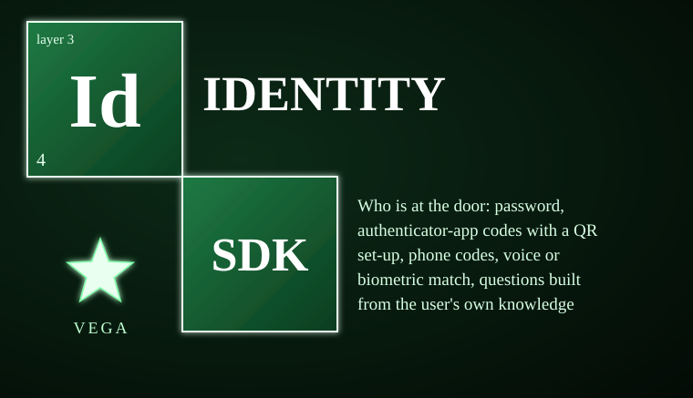
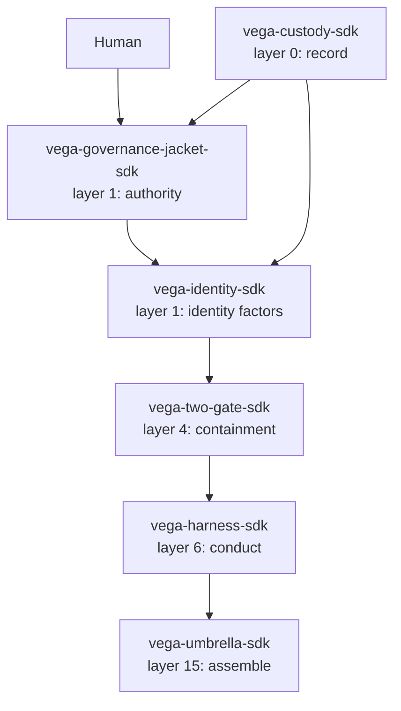

# vega-identity-sdk



**Who is at the door:** password, authenticator-app codes with a QR set-up, phone codes, voice or biometric match, questions built from the user's own knowledge graph, and the assurance level each action needs.

> **Licensing.** Source-available, not open source. Free for personal use; free for registered small businesses (under US$1M revenue and valuation); everyone else needs a commercial license (see LICENSE; for a commercial license write to jasonblasiak.ai.mail@gmail.com). Patent pending. Draft licence text, not yet reviewed by an attorney.

## At a glance

| Item | Value |
|------|-------|
| **Version** | 0.1.0 |
| **Python** | >=3.10 |
| **Dependencies** | `cryptography>=42`, `vega-custody-sdk`, `vega-governance-jacket-sdk` |
| **Tests** | 67 tests in 3 files, all passing |
| **Status** | **BUILT** (all 7 modules); designed-only: account recovery, speaker-recognition model, network layer |
| **Layer** | 1 (authority) — extends `vega-governance-jacket-sdk` with factor verification |
| **Platform** | Windows, macOS, Linux (pure Python); voice factor hardware-dependent |

## Table of contents

- [Why this exists](#why-this-exists)
- [End-to-end functions](#end-to-end-functions)
- [Controls](#controls)
- [What it cannot do](#what-it-cannot-do)
- [Platform support](#platform-support)
- [Standalone & unified install](#standalone--unified-install)
- [Diagnostic control](#diagnostic-control)
- [Fail-closed constraints & custom constraints](#fail-closed-constraints--custom-constraints)
- [Where it sits in the family](#where-it-sits-in-the-family)
- [License](#license)

## Why this exists

Identity is the first gate. Before a human can sign a commitment, the system must know who is asking. Policies and prompts cannot enforce this: a model can be tricked into skipping a check, a prompt can be overridden, and a "trusted" agent can be compromised. This kit replaces policy with mechanics: every factor is a cryptographic check that **fails closed**, every attempt is recorded to an append-only chain, and the assurance level is computed from fresh, single-use factors — not from a claim the model makes.

The kit owns exactly one concern: verifying a person's presence through multiple independent factors and translating that into an assurance level the governance jacket can trust. It does not manage sessions, cookies, or network transport. It does not decide what actions are allowed — that belongs to the jacket. It produces a short-lived signed assertion saying "this user reached level L with these families at this time" so the jacket can decide whether to spend a commitment.

## End-to-end functions

1. **Enrol** — Create a user record with a password (scrypt + optional pepper). The chain records `ID_ENROLLED` with a keyed hash of the username; no secrets touch the chain.
2. **Add factors** — Confirm TOTP (with QR), set phone (E.164), enrol device key (Ed25519), enrol voice (4+ audio samples), feed knowledge questions from private DKG sources.
3. **Login** — Obtain a `Login` handle. Each factor method (`password`, `totp`, `phone_start`/`phone_check`, `device_challenge`/`device_key`, `voice_challenge`/`voice_verify`, `knowledge_start`/`knowledge_finish`) returns `True` only on success.
4. **Record** — Every success writes `ID_FACTOR_OK` to the chain; every failure writes `ID_FACTOR_FAIL` and increments a per-person counter. Five failures lock the account (1 min, then doubling to 1 day). Unknown users get the same timing and the same "no" — no enumeration. Failures older than 15 minutes stop counting, passing one factor does NOT clear the count, and one person's attempts run one at a time, so a burst of parallel guesses is counted exactly.
5. **Assert** — Call `assertion()` to get a signed, short-lived assertion (`level`, `families`, `used` factors, `expiry`). The chain records `ID_ASSERTION`. If the chain write fails, the assertion is refused.

## Controls

| Entry point | Module | What it does |
|-------------|--------|--------------|
| `hash_password` / `verify_password` | `password` | scrypt with per-user salt, optional pepper, strength floor (12 chars, 5 unique, not common, no name), rehash detection |
| `new_secret`, `code`, `verify`, `otpauth_uri` | `totp` | RFC 6238 TOTP (SHA-1/256/512), 6-8 digits, 15-120s step, ±1 window, replay protection via counter |
| `encode`, `to_svg`, `to_text` | `qr` | Byte-mode QR (versions 1-9, up to 180 bytes, error correction M) for TOTP URI |
| `PhoneChallenges.start` / `check` | `phone` | 6-8 digit codes, 300s TTL, 5 attempts, 3 sends/hour, send function injected by caller |
| `QuestionBank.add` / `start_quiz` / `Quiz.answer` / `result` | `knowledge` | Private-source facts only; answers stored as salted keyed hashes; questions burned on ask; 3 starts/hour; exponential lockout on failure |
| `TemplateVault.seal/open`, `FeatureMatcher.enroll/match`, `Liveness.challenge/check`, `VoiceFactor.enroll/verify` | `biometric` | AES-256-GCM per-user templates; statistical reference matcher (replaceable); 4-word spoken challenge; recording replay detection |
| `level_of`, `required_level`, `issue`, `verify`, `allow` | `assurance` | 3 families (knows/has/is), 5 weights, 5 levels (0-4); 15-min freshness; signed HMAC assertions; fail-closed `allow` |
| `Identity.enrol` / `login` / `Login.*` / `assertion` | `service` | Orchestrates all factors; one failure counter; chain-first recording; dummy hash for unknown users |

## What it cannot do

- Voice can be cloned and phone numbers can be taken over (SIM swap): neither factor can carry an action alone.
- A knowledge question exposes one fact each time it is shown; people who know the user well can guess some answers: it adds assurance, never enough alone for the highest levels.
- The assertion says who got in and how strongly; it never replaces the human's signature on a commitment.
- State lives in the caller's object: the caller must keep it (and all secrets) in an encrypted store.
- No account recovery is built — recovery is the dangerous part of any identity system and needs its own design with a human in the loop.
- No network layer, no session cookies, no transport security — the caller supplies `send(number, text)` for phone codes and audio I/O for voice.
- Not independently security-reviewed; cryptography not expert-reviewed; not hardened for production.
- The speaker-recognition model and speech-to-text are plug-ins — not included; the reference matcher is statistical only.

## Platform support

| Capability | Support |
|------------|---------|
| Core (password, TOTP, QR, phone, knowledge, assurance, service) | Runs anywhere CPython 3.11+ runs: Windows, macOS, Linux |
| Biometric `FeatureMatcher` (statistical) | Runs anywhere CPython 3.11+ runs |
| Biometric `VoiceFactor` (with real speaker model) | Hardware-dependent; designed or partial per STATUS.md (speaker model and STT are plug-ins) |
| Mobile (Android/iOS) | No native mobile build is published. The SDK is pure Python and can run inside a Python runtime on Android (Termux) or Apple platforms (BeeWare/Kivy) where that runtime supports its dependencies. |

## Standalone & unified install

**Standalone:** `pip install -e .` installs `vega_identity` with declared dependencies `cryptography>=42`, `vega-custody-sdk`, `vega-governance-jacket-sdk`. It imports `vega_custody.dag.dag` and `vega_jacket.humanauth` — two down-layer family SDKs. It does not import any same-layer or up-layer SDKs.

**Unified:** Registered in `vega-umbrella-sdk` registry at layer 1 (authority) as a dependency of `vega-governance-jacket-sdk` (which it extends with factor verification). The umbrella resolves inter-SDK wiring; this kit's registry entry is:

```python
{
    "name": "vega-identity-sdk",
    "layer": 1,
    "requires": ["vega-custody-sdk", "vega-governance-jacket-sdk"],
    "provides": ["identity_factors", "assurance_levels"]
}
```

## Diagnostic control

- No console scripts (`console_scripts` not declared in pyproject.toml).
- Introspection: `Identity.ref(user)` returns keyed user hash; `Login.passed` shows factors passed with timestamps; `assurance.level_of(passed)` returns `{level, families, weight, used}`.
- Log surface: Chain records `ID_ENROLLED`, `ID_FACTOR_OK`, `ID_FACTOR_FAIL`, `ID_LOCKED`, `ID_ASSERTION` — each with `user_ref` (keyed hash), factor name, and level; never secrets.
- Fail-closed indicators: Any factor method returns `False`/`None` on error; `assertion()` returns `None` if chain write fails or user locked/unknown.
- Environment variables honored: None (clock, send, pepper, keys injected via constructor).

A diagnostic UI design for this layer exists in the Vega OS interface program (`identity_verification.html`); it is not shipped with this package.

## Fail-closed constraints & custom constraints

Every factor check fails closed: wrong input → `False`; malformed record → `False`; expired → `False`; chain write failure → `False`; missing plug-in → `False`; exception in plug-in → `False`.

| Point | Module/Function | Mechanism |
|-------|-----------------|-----------|
| Password verify | `password.verify_password` | Malformed record → `False`; constant-time compare |
| TOTP verify | `totp.verify` | Wrong code/expired/replay → `(False, last_counter)`; all candidates compared (timing-safe) |
| Phone check | `phone.PhoneChallenges.check` | Expired/wrong user/wrong code/attempts exhausted → `False`; challenge deleted |
| Knowledge quiz | `knowledge.Quiz.result` | Unanswered → exception; wrong answers → lockout; wrong pepper → cannot grade |
| Biometric verify | `biometric.VoiceFactor.verify` | Missing extractor/transcriber → `{"ok": False, "why": "..."}`; recording replay → `False`; exception → `False` |
| Assurance level | `assurance.level_of` | Stale/unknown factors ignored; level 0 if none fresh |
| Assertion verify | `assurance.verify` | Bad MAC / expired / future / wrong TTL → `False` |
| Allow check | `assurance.allow` | Requires valid assertion AND level >= required_level(action) |
| Service factor | `service.Login._pass` | Chain write first → `False` if chain fails |
| Service lockout | `service.Identity._fail` | 5 failures → lock; locked → all factors return `False` |
| Enrol/Assertion | `service.Identity.enrol` / `Login.assertion` | Chain write failure → refuse enrol / return `None` |

**Custom constraints:** This version publishes no user-defined constraint hooks; constraints are fixed by the module and the jurisdiction floor. User-defined constraints may be STRICTER than the legal minimum for the applicable jurisdiction, never looser. Jurisdictional legal minimums are defined by the jurisdiction registry (vega-jurisdiction-sdk); a custom constraint that would drop below a registered minimum is rejected at the gate.

## Where it sits in the family

One family, one organism: every SDK owns exactly one concern and uses the owner of every other concern instead of growing its own copy.



**Layer 1 (authority):** `vega-governance-jacket-sdk` owns human-only commitments and gates. `vega-identity-sdk` extends it with factor verification and assurance levels.

**Depends on (down-layer only):**
- `vega-custody-sdk` (layer 0) — append-only dag for chain records
- `vega-governance-jacket-sdk` (layer 1) — `humanauth.is_human_only` for action classification

**Consumed by (up-layer):**
- `vega-two-gate-sdk` (layer 4) — uses assurance assertions for containment decisions
- `vega-harness-sdk` (layer 6) — uses identity for predicted path authorization
- `vega-umbrella-sdk` (layer 15) — assembles the full organism

## License

> **Licensing.** Source-available, not open source. Free for personal use; free for registered small businesses (under US$1M revenue and valuation); everyone else needs a commercial license (see LICENSE; for a commercial license write to jasonblasiak.ai.mail@gmail.com). Patent pending. Draft licence text, not yet reviewed by an attorney.
