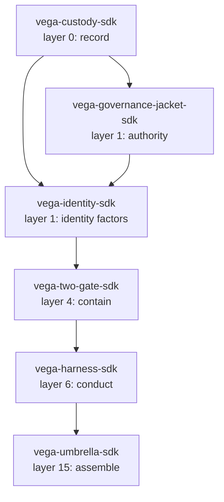

# vega-identity-sdk — Specification

Spec v1.0 — 2026-10-19 — describes the published reference implementation as tested; where this document and the source disagree, the source wins.

## At a glance

| Item | Value |
|------|-------|
| **Version** | 0.1.0 |
| **Python** | >=3.10 |
| **Dependencies** | `cryptography>=42`, `vega-custody-sdk`, `vega-governance-jacket-sdk` |
| **Tests** | 67 tests in 3 files, all passing |
| **Status** | **BUILT** (all 7 modules); designed-only: account recovery, speaker-recognition model, network layer |
| **Layer** | 1 (authority) — extends `vega-governance-jacket-sdk` with factor verification |

## Table of contents

- [1. Purpose and scope](#1-purpose-and-scope)
- [2. Vocabulary](#2-vocabulary)
- [3. Components](#3-components)
  - [3.1 password.py](#31-passwordpy)
  - [3.2 totp.py](#32-totppy)
  - [3.3 qr.py](#33-qrpy)
  - [3.4 phone.py](#34-phonepy)
  - [3.5 knowledge.py](#35-knowledgepy)
  - [3.6 biometric.py](#36-biometricpy)
  - [3.7 assurance.py](#37-assurancepy)
  - [3.8 service.py](#38-servicepy)
- [4. Guarantees and non-guarantees](#4-guarantees-and-non-guarantees)
- [5. Failure modes](#5-failure-modes)
- [6. Dependencies and layer rules](#6-dependencies-and-layer-rules)
- [7. Conformance](#7-conformance)

## 1. Purpose and scope

This specification covers the `vega_identity` package (src layout, version 0.1.0). It defines seven modules that together verify a person's presence through multiple independent factors and translate the result into an assurance level. The kit owns exactly one concern: factor verification and assurance computation. It does not cover session management, network transport, account recovery, or policy decisions about which actions require which level — those belong to the governance jacket (vega-governance-jacket-sdk) and the umbrella (vega-umbrella-sdk).

**Out of scope:** hardware speaker-recognition models, speech-to-text engines, SMS gateways, mobile app builds, production hardening, independent security review, expert cryptographic review.

## 2. Vocabulary

| Term | Definition |
|------|------------|
| **Factor** | A single verification method: password, TOTP, phone code, knowledge quiz, device key, voice |
| **Family** | Group of factors by type: knows (password, knowledge), has (totp, phone, device_key), is (voice) |
| **Assurance level** | Integer 0–4 derived from fresh factors, their families, and weights |
| **Fresh** | A factor passed within the last 15 minutes (MAX_AGE) |
| **Commitment** | A human-signed, single-use authorisation for a specific action (defined in vega-governance-jacket-sdk) |
| **Assertion** | A short-lived HMAC-signed statement: user_ref, level, families, used factors, issued, expiry, nonce |
| **Chain** | The append-only dag from vega-custody-sdk; every factor event and assertion is recorded |
| **Pepper** | A server-side secret mixed into hashes; stored separately from records |
| **Salt** | Per-record random bytes (password) or per-question random bytes (knowledge) |
| **Replay protection** | A used factor cannot be used again: TOTP via counter, phone via challenge deletion, voice via audio digest, knowledge via question burn |
| **Lockout** | Exponential backoff after 5 failures: 1 min, 2 min, 4 min, ... up to 1 day |
| **DKG** | Decentralized knowledge graph (vega-dkg-lattice-sdk); source of private facts for knowledge questions |

## 3. Components

### 3.1 password.py

**Role:** The 'something you know' factor — scrypt hashing with per-user salt, optional pepper, strength floor, constant-time verification, rehash detection.

**Public interface:**

```python
hash_password(password, pepper=b"", n=N_DEFAULT, r=R_DEFAULT, p=P_DEFAULT, check_strength=True, user="") -> str
verify_password(password, record, pepper=b"") -> bool
strength_problems(password, user="") -> list[str]
needs_rehash(record, n=N_DEFAULT, r=R_DEFAULT, p=P_DEFAULT) -> bool
PasswordRefused  # exception
```

**Behavior:** On success, returns scrypt record `scrypt$N$r$p$salt$hash` with embedded parameters. On failure (weak password, bad params, malformed record, wrong password), raises `PasswordRefused` or returns `False` — never an exception from `verify_password`.

**Invariants:**
- Salt is 16 random bytes per record
- Pepper is HMAC-SHA256 mixed before scrypt; stolen records alone cannot be cracked offline
- Strength floor: >=12 chars, >=5 unique chars, not in common list, no account name, no patterns
- Cost N must be power of two >= 1024 and <= 2^20
- Unicode NFKC normalization before hashing
- Constant-time comparison via `hmac.compare_digest`
- Malformed records parse to `None` → `verify_password` returns `False`

### 3.2 totp.py

**Role:** The authenticator-app factor — RFC 6238 TOTP with QR set-up, replay protection via counter.

**Public interface:**

```python
new_secret(nbytes=20) -> str  # base32
code(secret, at=None, step=30, digits=6, algo="sha1") -> str
verify(secret, supplied, now=None, last_counter=-1, step=30, digits=6, algo="sha1", window=1) -> (bool, int)
counter_of(at, step=30) -> int
otpauth_uri(secret, account, issuer, step=30, digits=6, algo="sha1") -> str
TotpRefused  # exception
```

**Behavior:** `verify` returns `(True, counter)` on success; caller must store `counter` as new `last_counter`. Accepts current step ±window (default 1). Rejects replay: `hit <= last_counter` → `False`. Constant-time: all candidate steps compared.

**Invariants:**
- Secret: 16–64 bytes, base32 encoded
- Step: 15–120 seconds; digits: 6, 7, or 8; algo: sha1, sha256, sha512
- Window: 0–2 steps
- Account/issuer: printable, no colon, length limits
- Base32 decode validates; bad secret → `TotpRefused`
- Non-digit/non-ASCII/wrong-length supplied → `False` immediately

### 3.3 qr.py

**Role:** Byte-mode QR encoder (versions 1–9, error correction M, up to 180 bytes) for TOTP set-up URI — no external dependency.

**Public interface:**

```python
encode(text) -> list[list[bool]]  # grid, no quiet zone
to_svg(grid, scale=6) -> str
to_text(grid) -> str
QRRefused  # exception
```

**Behavior:** Returns boolean grid; SVG includes 4-module quiet zone. Tested against OpenCV decoder when available.

**Invariants:**
- Input: 1–180 bytes UTF-8
- Version auto-selected (smallest that fits)
- Mask pattern chosen by penalty minimization (8 masks)
- Finder patterns, timing patterns, alignment patterns, version info, format info all placed per QR spec
- Not a general QR library: no numeric/alphanumeric/kanji modes, no Micro QR, no structured append

### 3.4 phone.py

**Role:** The 'something you have (weak)' factor — one-time phone codes with expiry, attempt limits, send limits; delivery injected by caller.

**Public interface:**

```python
valid_number(number) -> bool  # E.164: ^+[1-9][0-9]{7,14}$
masked(number) -> str  # shows first 2 and last 2 digits
PhoneChallenges(send, pepper, clock=time.time, ttl=300, max_attempts=5, max_sends=3, window=3600, digits=6, max_open=1000)
PhoneChallenges.start(user, number) -> str  # challenge id
PhoneChallenges.check(cid, user, code) -> bool
PhoneRefused  # exception
```

**Behavior:** `start` sends code via injected `send(number, text)`; stores only salted keyed hash of code and number. `check` verifies HMAC, enforces expiry/attempts, deletes challenge on success or max attempts. Send rate limited per number (3/hour). Open challenges capped.

**Invariants:**
- Pepper: >=16 bytes, required
- Code never logged, never returned, never in chain
- Number stored only as keyed hash for rate limiting
- Failed send → no challenge created
- Wrong user on check → `False` (MAC includes user)

### 3.5 knowledge.py

**Role:** Governor for questions the model builds from private DKG sources — filters, stores answers as salted keyed hashes, burns questions on ask, enforces lockouts.

**Public interface:**

```python
normalise(text) -> list[str]  # NFKC, casefold, remove stop words
QuestionBank(pepper, clock=time.time, min_pool=12)
QuestionBank.add(question, accepted, source, source_ref="", topic="general", need_ratio=0.8) -> str  # qid
QuestionBank.available() -> bool
QuestionBank.start_quiz(count=3, need=2) -> Quiz
Quiz.questions() -> list[(qid, text)]
Quiz.answer(qid, text) -> None
Quiz.result() -> bool
QuestionBank.to_dict() / from_dict(cls, d, pepper, clock)
KnowledgeRefused  # exception
```

**Behavior:** `add` refuses public sources, sensitive content (identifiers, money, health, passwords), weak answers (<4 chars key words, yes/no, digits only <3), duplicate questions. Answers stored as salted keyed HMAC-SHA256 hashes of key words. `start_quiz` picks unused questions, prefers topic spread, burns them to "asked" state immediately. `Quiz.result` requires all questions answered; pass needs `need` correct; failure increments lockout (1 min, 2 min, 4 min...).

**Invariants:**
- Sources: only `private_session`, `private_note`, `private_file`
- Sensitive filter: regex + `vega_custody.dag.dag.contains_credential`
- Each question used once (state: unused → asked → answered_ok/answered_wrong)
- Minimum pool: 12 unused questions before quiz available
- Quiz starts limited: 3 per hour
- Lockout: exponential, max 1 day
- Stolen bank reveals no answers (pepper + salt per question)
- Flood guard: answer tokens > 3×variant + 3 rejected

### 3.6 biometric.py

**Role:** The 'something you are' factor — encrypted templates, statistical feature matcher, spoken-phrase liveness, fail-closed voice factor; pluggable extractor/transcriber.

**Public interface:**

```python
TemplateVault(key: bytes)  # seal(user, template) -> bytes, open(user, blob) -> dict
FeatureMatcher.MIN_SAMPLES=4  # enroll(samples) -> dict, match(template, vector) -> (bool, float)
Liveness(clock, ttl=60, words=4, need_ratio=0.75)  # challenge() -> (cid, phrase), check(cid, transcript) -> bool
VoiceFactor(vault, extract=None, transcribe=None, matcher=None, liveness=None, clock)
VoiceFactor.enroll(user, audio_samples) -> bytes  # sealed template
VoiceFactor.verify(user, sealed_template, challenge_id, audio) -> dict  # ok, distance, why
BiometricRefused  # exception
```

**Behavior:** `TemplateVault` uses AES-256-GCM with user-bound AAD. `FeatureMatcher` computes per-feature mean/scale from samples; limit from leave-one-out distances (min 2.0, 2×max LOO). `Liveness` gives random phrase, single-use, expires. `VoiceFactor.verify` checks liveness phrase match, then feature match; records audio digest to prevent replay; fails closed if extractor/transcriber missing or crash.

**Invariants:**
- Vault key: exactly 32 bytes
- Template: dict with mean, scale, limit, n; encrypted per user
- Feature vector: 4–512 finite floats
- Enrollment: >=4 samples, same length
- Liveness: challenge consumed on check (success or fail); 3/4 words required by default
- Voice factor: recording replay detected via SHA-256 digest (keeps last 200)
- No raw audio or templates in chain; only ok/rounded distance
- Speaker model and STT are plug-ins — not included; reference matcher is statistical only

### 3.7 assurance.py

**Role:** Computes assurance level from fresh factors; maps actions to required levels; issues/verifies signed assertions.

**Public interface:**

```python
level_of(passed: dict, now=None) -> dict  # level, families, weight, used
required_level(action) -> int
issue(secret, user_ref, passed, now=None, ttl=MAX_AGE) -> dict  # with mac
verify(secret, assertion, now=None) -> bool
allow(secret, assertion, action, now=None) -> bool
AssuranceRefused  # exception
# Constants: MAX_AGE=900, FAMILY, WEIGHT, CLASS_LEVEL
```

**Behavior:** `level_of` filters stale (>15 min) and unknown factors. Level logic: 0=none, 1=any fresh, 2=2 families + weight>=3, 3=weight>=5 + strong 'has' factor, 4=3 families + weight>=7 + device_key or totp. `required_level` returns 4 for HUMAN_ONLY actions (from jacket) and unknown actions. `issue` creates HMAC-SHA256 signed assertion. `verify` checks MAC, expiry, issued<=now<expiry, TTL<=MAX_AGE. `allow` = verify AND level >= required.

**Invariants:**
- Freshness: 15 minutes (same as commitment lease)
- Families: knows (password=1, knowledge=2), has (totp=2, phone=1, device_key=3), is (voice=1)
- Phone and voice weight=1 (SIM swap, cloning) — cannot lift past level 1 alone
- HUMAN_ONLY actions always need level 4
- Assertion secret: >=32 bytes; TTL: 1–900 seconds
- MAC covers all fields; constant-time compare
- `allow` fails closed: invalid/expired assertion → `False`

### 3.8 service.py

**Role:** Orchestrates enrolment, login, factor verification, lockout, chain recording, assertion issuance.

**Public interface:**

```python
Identity(dag, secret, pepper, vault_key, clock=time.time, send=None, voice=None, scrypt_n=N_DEFAULT, issuer="Vega")
Identity.enrol(user, password)
Identity.begin_totp_setup(user) -> uri
Identity.confirm_totp(user, code) -> bool
Identity.set_phone(user, number)
Identity.enrol_device_key(user, public_bytes)
Identity.enrol_voice(user, audio_samples)
Identity.knowledge_bank(user) -> QuestionBank
Identity.login(user) -> Login
Login.password(text) -> bool
Login.totp(code) -> bool
Login.phone_start() -> bool   # only after a password, authenticator code or device key has passed in this login; before that it sends nothing and returns False
Login.phone_check(code) -> bool
Login.device_challenge() -> bytes|None
Login.device_key(signature) -> bool
Login.voice_challenge() -> str|None
Login.voice_verify(audio) -> bool
Login.knowledge_start() -> list[(qid, text)]|None   # only after a password, authenticator code or device key has passed in this login; before that it shows no question, burns no quiz start, and returns None
Login.knowledge_finish(answers) -> bool
Login.assertion() -> dict|None
IdentityRefused  # exception
```

**Behavior:** `enrol` hashes password, writes `ID_ENROLLED` to chain first — fails if chain write fails. `Login` methods: unknown/locked user → same timing (dummy hash), same `False`. `_pass` writes `ID_FACTOR_OK` to chain first — returns `False` if chain fails. `_no` increments failure counter, writes `ID_FACTOR_FAIL`, locks at 5. `device_challenge` generates single-use nonce. `device_key` verifies Ed25519 signature over `VEGA-DEVICE-LOGIN-1|user|nonce`. `voice_challenge`/`voice_verify` delegate to `VoiceFactor`. `knowledge_start`/`finish` delegate to `QuestionBank`/`Quiz`. `assertion` issues via `assurance.issue`, writes `ID_ASSERTION` to chain first — returns `None` if chain fails.

**Invariants:**
- User names: 3–40 lowercase, digits, . _ -
- One failure counter across all factors
- Locked user: all factors return `False`/`None`
- Chain records: `user_ref` (keyed hash), factor, level — never secrets
- TOTP counter saved before success reported
- Device challenge single-use (consumed on verify attempt)
- Quiz starts: 3/hour limit
- Unknown user: dummy password hash for timing equality

## 4. Guarantees and non-guarantees

### Guarantees

| Guarantee | Module | Test |
|-----------|--------|------|
| Password strength floor enforced | password | `test_the_strength_floor` |
| Constant-time password verify | password | `test_malformed_records_and_inputs_never_raise_and_never_pass` |
| Pepper separates offline cracking | password | `test_pepper_is_part_of_the_hash` |
| TOTP replay prevented | totp | `test_window_replay_and_reuse` |
| TOTP constant-time verify | totp | `test_window_replay_and_reuse` (all candidates compared) |
| QR encodes/decodes correctly | qr | `test_codes_decode_for_every_version_and_for_the_real_setup_uri` |
| Phone codes expire, limited attempts, rate limited | phone | `test_expiry`, `test_wrong_codes_burn_attempts_and_then_kill_the_challenge`, `test_send_limits_and_open_cap` |
| Phone code never in chain/logs | phone | `test_the_stored_hash_does_not_hold_the_code` |
| Knowledge questions from private sources only | knowledge | `test_facts_are_filtered` (public_web refused) |
| Knowledge answers salted keyed hashed | knowledge | `test_a_stolen_bank_holds_no_answers` |
| Knowledge questions burned on ask | knowledge | `test_a_quiz_grades_by_keywords_and_burns_every_question_it_shows` |
| Knowledge lockout exponential | knowledge | `test_wrong_and_padded_answers_fail_and_wrong_quizzes_lock_for_longer` |
| Biometric template encrypted per user | biometric | `test_the_vault_encrypts_per_user` |
| Voice factor fails closed without plug-ins | biometric | `test_missing_plug_ins_and_crashes_fail_closed` |
| Voice recording replay detected | biometric | `test_a_recording_cannot_be_used_twice_and_a_template_cannot_be_used_by_another_user` |
| Assurance level logic correct | assurance | `test_the_level_table` |
| Stale factors ignored | assurance | `test_stale_future_and_unknown_factors_count_for_nothing` |
| Assertion signed, short-lived, verified | assurance | `test_assertions_are_signed_short_and_checked` |
| Allow requires level >= action | assurance | `test_allow_needs_a_genuine_assertion_at_the_actions_level` |
| Service: chain write before success | service | `test_if_the_chain_cannot_be_written_nothing_succeeds` |
| Service: unknown users timed equally | service | `test_unknown_and_locked_people_get_the_same_plain_no` |
| Service: lockout shared across factors | service | `test_failures_on_any_factor_share_one_counter` |
| Service: locked blocks all factors | service | `test_a_locked_person_cannot_pass_other_factors_either` |
| Service: ref is keyed hash not name | service | `test_the_ref_is_a_keyed_hash_not_the_name` |

### Non-guarantees

| Non-guarantee | Explanation |
|---------------|-------------|
| Account recovery | Not built; needs own design with human in loop |
| Speaker recognition | Plug-in; reference matcher is statistical only |
| Network/session layer | Not included; caller supplies send, audio I/O |
| Production hardening | Not independently security-reviewed |
| Expert crypto review | Cryptography not expert-reviewed |
| SIM swap protection | Phone factor weight=1, cannot carry alone |
| Voice cloning protection | Voice factor weight=1, cannot carry alone |
| Knowledge guessing | Adds assurance only; never enough alone for level 4 |

## 5. Failure modes

| Failure | Behavior | Test |
|---------|----------|------|
| Tampered password record | `verify_password` → `False` (malformed parse) | `test_malformed_records_and_inputs_never_raise_and_never_pass` |
| TOTP replay (same code) | `verify` → `(False, last_counter)` | `test_window_replay_and_reuse` |
| TOTP replay (older step) | `verify` → `(False, last_counter)` | `test_window_replay_and_reuse` |
| Phone code expired | `check` → `False` | `test_expiry` |
| Phone wrong code ×5 | Challenge deleted, even right code → `False` | `test_wrong_codes_burn_attempts_and_then_kill_the_challenge` |
| Phone send limit exceeded | `start` → `PhoneRefused` | `test_send_limits_and_open_cap` |
| Knowledge public source | `add` → `KnowledgeRefused` | `test_facts_are_filtered` |
| Knowledge sensitive content | `add` → `KnowledgeRefused` | `test_facts_are_filtered` |
| Knowledge weak answer | `add` → `KnowledgeRefused` | `test_facts_are_filtered` |
| Knowledge question reused | `start_quiz` never returns same qid | `test_a_quiz_grades_by_keywords_and_burns_every_question_it_shows` |
| Knowledge quiz failed ×N | Lockout: 1 min, 2 min, 4 min... | `test_wrong_and_padded_answers_fail_and_wrong_quizzes_lock_for_longer` |
| Biometric template tampered | `open` → `BiometricRefused` (InvalidTag) | `test_the_vault_encrypts_per_user` |
| Biometric wrong user | `open` → `BiometricRefused` | `test_the_vault_encrypts_per_user` |
| Voice missing extractor/STT | `verify` → `{"ok": False, "why": "voice factor is not fully configured"}` | `test_missing_plug_ins_and_crashes_fail_closed` |
| Voice plug-in crash | `verify` → `{"ok": False, "why": "the voice check could not run"}` | `test_missing_plug_ins_and_crashes_fail_closed` |
| Voice recording replay | `verify` → `{"ok": False, "why": "this recording was already used"}` | `test_a_recording_cannot_be_used_twice_and_a_template_cannot_be_used_by_another_user` |
| Assertion MAC mismatch | `verify` → `False` | `test_assertions_are_signed_short_and_checked` |
| Assertion expired | `verify` → `False` | `test_assertions_are_signed_short_and_checked` |
| Assertion level tampered | `verify` → `False` | `test_assertions_are_signed_short_and_checked` |
| Chain write fails on enrol | `enrol` → `IdentityRefused` | `test_if_the_chain_cannot_be_written_nothing_succeeds` |
| Chain write fails on factor | `Login._pass` → `False` | `test_if_the_chain_cannot_be_written_nothing_succeeds` |
| Chain write fails on assertion | `assertion` → `None` | `test_if_the_chain_cannot_be_written_nothing_succeeds` |
| User enumeration | Unknown/locked → same timing, same `False` | `test_unknown_and_locked_people_get_the_same_plain_no` |

## 6. Dependencies and layer rules

Registry entry (verbatim from vega-umbrella-sdk):

```python
{
    "name": "vega-identity-sdk",
    "layer": 1,
    "requires": ["vega-custody-sdk", "vega-governance-jacket-sdk"],
    "provides": ["identity_factors", "assurance_levels"]
}
```

Dependencies point down layers only (layer 0: custody, layer 1: jacket), never up or sideways. No cycles.



## 7. Conformance

A third party can verify conformance by running the test suite:

```bash
PYTHONPATH=src:../vega-custody-sdk/src:../vega-governance-jacket-sdk/src python -m unittest tests/redteam_1_factors.py tests/redteam_2_service.py
```

Expected: 67 tests pass (40 + 17 + 10). Mutation test (`tests/mutations_identity.py`) should kill all but 3 known survivors (phone user binding — MAC covers user; knowledge topics — test non-deterministic; QR alignment patterns — no decoder test).

> **Passing means:** the published reference implementation behaves as specified.  
> **Passing does NOT mean:** production ready, independently security-reviewed, crypto expert-reviewed, resistant to side-channels beyond those tested, or suitable for protecting real secrets without further review.
